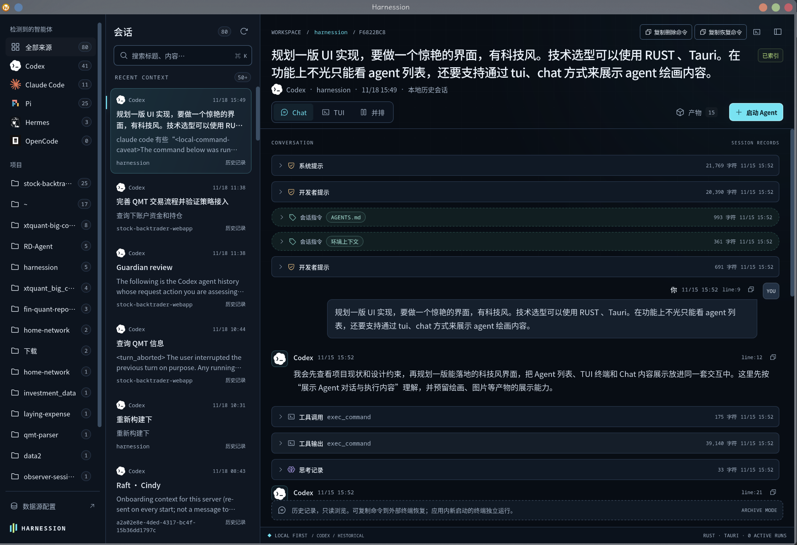

# Harnession - 一款纯粹的智能体会话管理工具



本地优先的 AI Agent 会话工作台：汇总本机 Codex、Claude Code、Pi、Hermes 和 Antigravity 会话，按项目归类并搜索。现有 Python CLI 之外，已提供 Tauri / Rust + React 桌面初版，支持 Chat、TUI 与图片附件浏览。详细范围见 [需求文档](docs/requirements.md) 和 [桌面开发说明](docs/desktop-development.md)。

桌面界面方向见 [UI 实现规划](docs/ui-implementation-plan.md)；[早期视觉原型](docs/ui-prototype.html) 保留为设计参考。正式界面源码位于 `apps/desktop`，通过结构化 JSONL 服务读取索引，桌面宿主管理真实 PTY。

## 桌面版

从 [GitHub Releases](https://github.com/evilpapa/harnession/releases) 下载 Linux x64 的 `.deb`、Apple Silicon 或 Intel Mac 的 `.dmg`，以及 Windows x64 的 `.exe` 安装程序。安装包自带 Python 索引服务。

从源码启动开发版：

```sh
uv sync --locked
cd apps/desktop
npm ci
npm run desktop:dev
```

首次运行需要 Rust、Node、uv 和平台对应的 Tauri 系统依赖。点击扫描升级已有索引的消息结构，保留旧会话内容与手动归属。使用 `npm run desktop:build` 正式打包。macOS 生成可从 Finder 打开的 `Harnession.app` 和 `.dmg` 安装镜像，包内自带 Python 索引服务。构建路径和平台验证记录见 [开发说明](docs/desktop-development.md)。

Windows 构建后，在仓库根目录运行 `./run.ps1` 即可启动免安装版。主程序和索引服务分别为 `apps/desktop/src-tauri/target/release/` 下的 `harnession-desktop.exe` 和 `harnession-gateway.exe`；复制到其他目录时请把两者放在一起。运行仍需 WebView2，启动脚本会为本次启动定位已安装的运行时。

## 开始使用

使用 `uv` 管理开发环境，仓库默认使用 Python 3.12。应用支持 Python 3.9 或更新版本，无运行时第三方依赖。安装 `uv` 后，在仓库目录执行：

```sh
uv sync --locked
uv run harnession scan
uv run harnession status
uv run harnession projects
uv run harnession list --limit 20
uv run harnession list --agent claude --search 关键词
uv run harnession list --agent pi --search 关键词
uv run harnession list --agent antigravity --search 关键词
uv run harnession list --project 项目路径片段
uv run harnession show 1
uv run harnession assign 1 /path/to/project
uv run harnession assign 1 --reset
```

这些命令在 Windows 上也可使用。列表中的数字是本地索引 ID；`show` 和 `assign` 使用该数字。

默认扫描 `~/.codex/sessions`、`~/.claude/projects`、`~/.pi/agent/sessions` 和 `~/.hermes/state.db`，支持 `CODEX_HOME`、`CLAUDE_CONFIG_DIR`、`PI_CODING_AGENT_DIR`、`HERMES_HOME`，也可用 `scan --codex 路径 --claude 路径 --pi 路径 --hermes 路径` 指定来源。Pi 还支持 `PI_CODING_AGENT_SESSION_DIR` 直接指定会话目录；优先级为 `--pi` > `PI_CODING_AGENT_SESSION_DIR` > `PI_CODING_AGENT_DIR/sessions` > 默认目录，支持 `~` 展开。Codex 的 `.jsonl.zst` 需要系统安装 `zstd` 并加入 PATH；其他格式不需要。未安装时会在扫描状态中报告失败。

Pi 递归扫描会话目录中的 `.jsonl`，支持 v1–v3 格式，从会话头部提取原始 ID 和工作目录，优先使用最后设置的会话名称；名称清除后回退到首条用户文本。一个文件对应一条索引，文件内所有分支按记录顺序汇总，保留压缩前的原始消息；收集用户/助手文本、工具调用与输出、已记录的思考及系统提示，不重建当前分支或模型上下文。扩展状态和未知事件类型会忽略；不支持的版本和损坏记录会报告失败并保留旧索引。

Antigravity 默认从 `~/.gemini` 查找桌面版 `antigravity` 和 CLI `antigravity-cli` 的数据。可通过 `scan --antigravity 路径`、`HARNESSION_ANTIGRAVITY_HOME` 或桌面数据源设置指定包含这两个目录的父目录，也可指定单个数据目录。优先从本地会话 SQLite 读取用户与助手文本，会话库不存在或没有对话文本时可读取现有的明文 JSONL 转录。摘要库提供原始标题与工作区，同一个会话 ID 合并为一条记录。旧版 `.pb` 会话需要已有的明文转录。Antigravity 支持历史搜索与阅读，工具、思考、附件以及原生改名、删除和恢复暂未接入。

Codex、Claude Code、Pi 和 Hermes 的可识别技术记录以独立类型保存，在 Chat 和 TUI 记录视图中默认折叠，展开后可阅读和复制完整内容。`AGENTS.md instructions`、`Role` 及显式环境/技能指令块使用单独的“会话指令”标签，样式区别于工具、思考记录；同条消息里的普通提问单独保留。检索包含折叠内容，列表摘要展示最后一次真实用户提问，无提问时显示“暂无用户提问”。仅收集来源实际保存的内容；加密或脱敏思考只标注原文不可读，不解密或推断缺失文本。桌面版打开旧索引时自动从已索引的原始来源补采记录，保留会话 ID 和手动项目归属。点击“扫描”可发现新增会话或重试失败的来源，扫描不会修改原始来源。

Chat 和 TUI 中，连续超过 10 条思考、工具调用/输出或系统提示会合并为一个默认折叠的“过程记录”分组，显示各类数量、失败和搜索命中提示。展开后仍可逐条阅读，底部可一键收起；普通对话及会话指令标签作为分组边界，加载后续消息时会合并连续记录。

以 `Base directory for this skill: <路径>` 开头的技能说明也使用独立的会话指令标签，显示技能名，整段 Markdown 默认折叠。技能正文继续支持搜索和完整复制，不作为列表中的用户提问摘要；普通引用及代码示例中的同名短语保持原样。

Claude Code 的本地命令提示、命令名和参数默认折叠，保留搜索和展开阅读，不参与标题或提问摘要。标题优先使用原生自定义名称，其次使用第一条实际提问。没有自定义名称和实际提问的本地命令会话显示为「本地命令会话」。桌面版启动时自动修正还能读取原始文件的旧索引。

点击会话详情标题旁的铅笔可修改名称。新标题写入 Codex、Claude Code、Pi 或 Hermes 的原生会话后，也会更新 Harnession 的列表、卡片、详情和搜索。Codex 和 Hermes 需要本机已安装支持改名的 CLI，且原始会话能由对应的 Agent 定位。

索引默认存于 Linux/macOS 的 `~/.local/share/harnession/index.sqlite3`（可用 `XDG_DATA_HOME` 覆盖），Windows 存于 `%LOCALAPPDATA%\harnession\index.sqlite3`。可设置 `HARNESSION_HOME` 或在子命令前传入 `--db 路径` 覆盖。索引包含会话文本，访问权限取决于本机用户与文件系统；删除该数据库可清除索引和手动归类，不会删除 Agent 的原始会话。工具不主动联网。

## 当前限制

- OpenCode 暂未实现，`status` 会明确标注。Pi 已使用本机 v3 会话验证，v1/v2 使用构造样本测试。Hermes 已适配本机数据库结构，尚未在有真实会话的数据集上验证。
- 索引可识别的对话、工具调用与输出、思考、系统/开发者提示及显式图片附件，不保证包含所有事件、云端或其他版本格式。扫描失败会保留旧索引并报告错误。
- 桌面端可在会话命令详情中直接删除 Codex、Claude Code 和 Pi 的单个会话文件。确认后，原始文件、本地消息和附件索引、手动项目归属一并清除，无法恢复。Hermes 保留复制原生命令的入口。原始会话在外部删除后仍可浏览缓存，并可在同一菜单中选择「删除索引」。无法确认来源是否缺失时，应用保留缓存。
- 搜索为大小写敏感的子串匹配，不是语义搜索。桌面初版支持历史阅读与启动新的 PTY；会话恢复、结构化实时 Chat 和跨 Agent 迁移尚未实现。
- 桌面包已在本机 Apple Silicon Mac 验证，Linux x86_64 有历史构建记录。Intel Mac 和 Windows 桌面包尚未实机验证。

## 开发验证

```sh
uv run --locked python -m unittest discover -s tests -v
```
